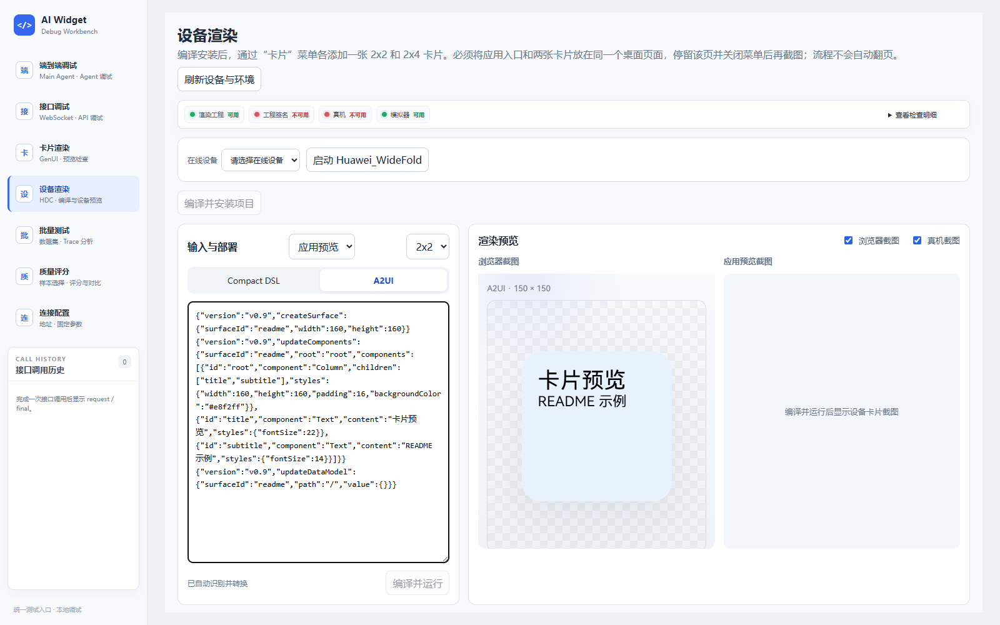
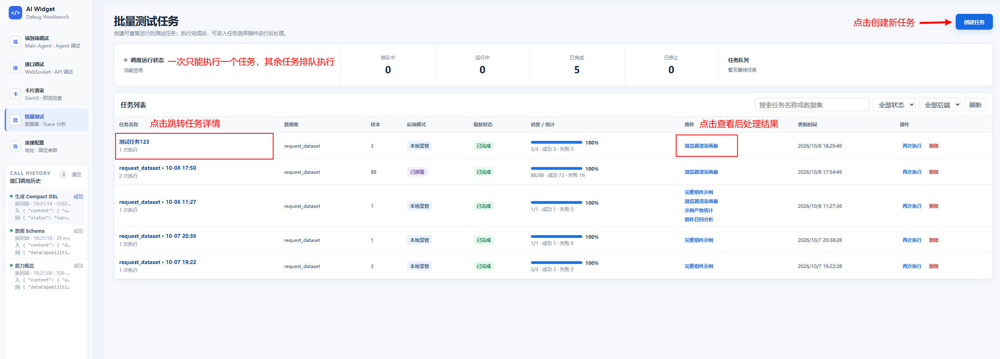
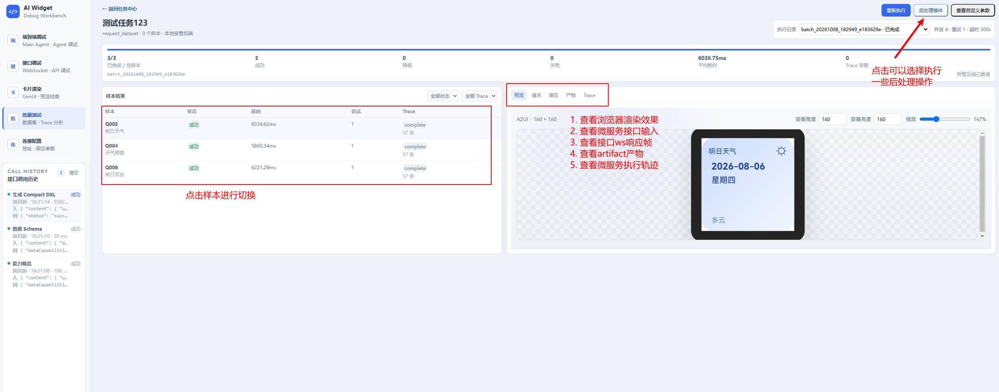
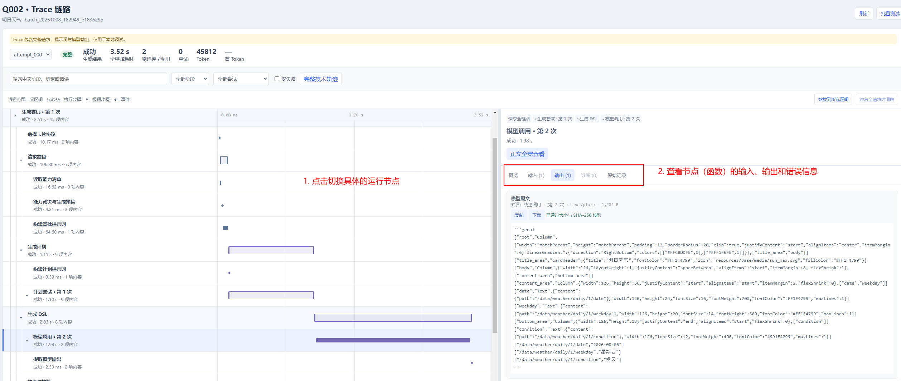
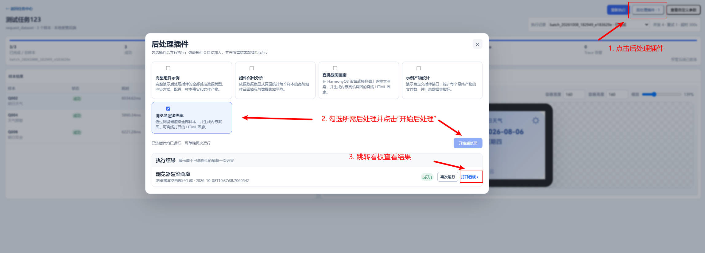
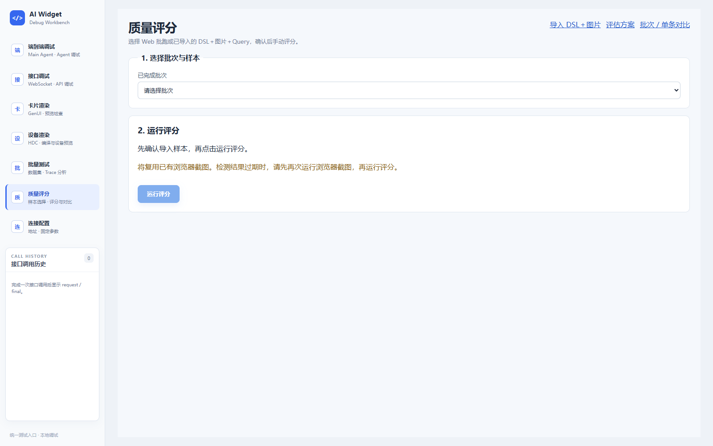
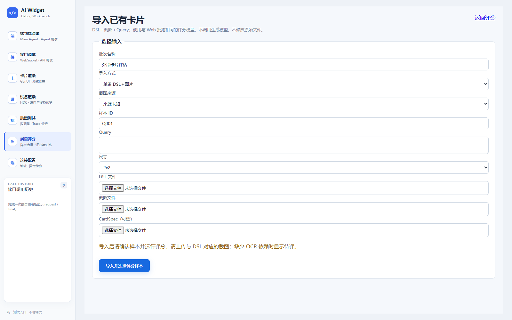
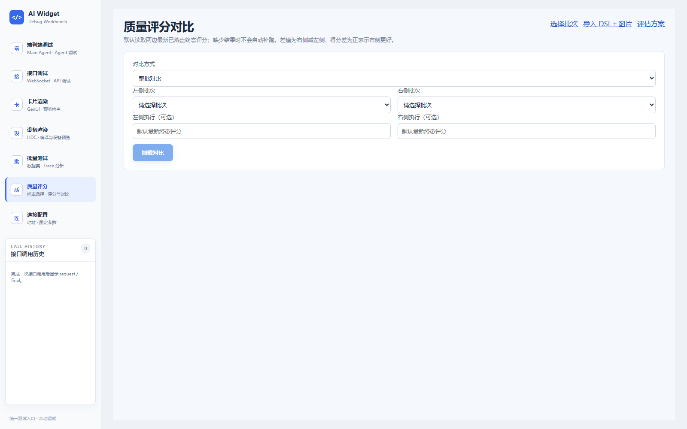

# AI Widget 调试工作台

`debug_tools` 是 AI 卡片云侧链路的本地浏览器工作台，支持端到端会话、接口调用、浏览器与设备预览、
数据集批跑、Trace 排查、后处理及质量评分。

## 功能入口

| 页面 | 适用场景 | 地址（工作台启动后） |
| --- | --- | --- |
| 端到端调试 | 验证用户需求经过 Main Agent、Skill、工具调用到结果回复的完整链路 | `/debug/end-to-end` |
| 接口调试 | 单独调用三个正式工具接口，构建请求并检查最终响应 | `/debug/interface` |
| 卡片渲染 | 粘贴代码或复用调用历史，检查布局、数据绑定与产物 | `/debug/renderer` |
| 设备渲染 | 转换代码，编译安装，查看应用预览或更新已加桌卡片并截图 | `/debug/device-render` |
| 批量测试 | 创建数据集任务，查看执行指标、逐样本结果、Trace 与后处理 | `/debug/batch` |
| 质量评分 | 选择批跑或导入已有卡片，评分并进行整批／单条对比 | `/debug/quality` |
| 连接配置 | 选择微服务，配置公共参数，检查本机工具链与设备环境 | `/debug/settings` |

## 快速启动

以下命令从仓库根目录执行，需要 Python 3.12，推荐使用 `uv`。

```powershell
uv sync
# 仅首次创建，已有本机配置时不要覆盖
Copy-Item debug_tools/debug_tool.yaml.example debug_tools/debug_tool.yaml
uv run debug_tools
```

打开 <http://127.0.0.1:8888/debug/>。已有依赖环境也可使用 `python -m debug_tools`。
仓库包含 `debug_tools/dist/`，直接启动不要求安装 Node.js。

按 [`debug_tool.yaml.example`](debug_tool.yaml.example) 的注释填写模型通道、对应凭据及本机路径。
实际 `debug_tool.yaml` 已被 Git 忽略，密钥只写入本机配置或 `widget_service/.env`。
缺少本机配置仍可打开工作台，但模型调用需要有效配置，设备能力按需报告缺失项。

| 启动方式 | 可用能力 |
| --- | --- |
| `uv run debug_tools`（默认 `full`） | 工作台全部页面及 Main Agent 后端 |
| `uv run debug_tools --mode frontend` | 接口调试、本地转换、渲染、设备、批跑和评分；不启用 Main Agent 和远程产物读取 |
| `uv run debug_tools --port 8890` | 修改工作台监听端口 |

### 连接微服务

进入“连接配置”，选择一种来源，两种调试页面共用该选择：

- **已部署微服务**：填写可访问的 WebSocket Base。默认是 `ws://127.0.0.1:8855/api/v1/ws/tools`。
  如需手动启动本地服务，在另一个终端从仓库根目录执行：

  ```powershell
  cd widget_service
  uv run cloud/start_websocket_server.py
  ```

- **本地受管微服务**：在页面启动，由工作台分配回环端口并管理进程；批跑也可选择该模式。

检查公共设备、版本和地区参数后保存，确认服务状态可用。Main Agent 地址与微服务地址分别配置。
浏览器连接与公共参数保存在本机浏览器；受管服务参数保存到本机 YAML，敏感值只显示来源。

Main Agent 与受管微服务共用 `widget_backend`。配置优先级、临时覆盖和保存规则见
[批量测试配置](batch_testing/README.md#本地受管)；直接手动启动微服务不读取调试平台 YAML。
配置模板的 `widget_backend` 优先于 `.env`，不要用空密钥覆盖有效凭据。
模型通道和凭据须匹配，修改 Main Agent 模型配置后重启工作台。


## 使用流程

### 端到端调试

输入需求或选择快捷提示，发送后检查助手回复、工具调用、运行轨迹和生成产物。
首次进入后，在工作台内切换页面会保留会话与草稿，正在执行的调用继续运行；“新建会话”清空上下文。
刷新、关闭浏览器或重启服务后的会话恢复暂不支持。


### 接口调试

选择顶部接口 Tab，填写业务参数并发送。会话标识和设备时间自动补齐。
响应可切换最终结果、原始 final 和构建 JSON；左侧历史可用于后续请求或卡片渲染。


### 卡片渲染

粘贴 A2UI、Compact DSL、Design Compact DSL 或产物 JSON，也可选择左侧调用历史。
点击“渲染”或开启自动渲染；Compact 通过 Python 转换，已有 A2UI 直接解析。
“Python 转换并渲染”会将编辑器替换为 A2UI。按需选择 `2×2`／`2×4` 预览画布、缩放及客户端版本，
在右侧检查产物并复制或下载。预览尺寸仅用于开发检查，不能作为真实桌面尺寸或真机验收依据。


### 设备渲染

需要 DevEco Studio、SDK、HDC 及设备／模拟器；路径统一配置在 `platform.environment`，
示例见本机 YAML 模板。Node、DevEco 缺失不阻止打开工作台，设备操作会显示不可用原因。
真机需要工程签名，模拟器可使用 unsigned HAP。

1. 选择在线设备；也可显式启动已配置的本地模拟器。
2. 粘贴 Compact DSL 或 A2UI，检查自动转换后的浏览器预览。
3. 默认“应用预览”模式，点击“编译并运行”，查看设备卡片截图和任务日志。
4. 如需桌面截图，先点击“编译并安装项目”，再手动各添加一张 `2×2` 和 `2×4` 卡片，
   放在同一个桌面页面并保持无遮挡、设备解锁；建议应用入口也放在该页。
   切换到桌面模式，点击“更新桌面卡片并截图”。不自动翻页、加桌或整理桌面。

浏览器与设备截图可分别显示。桌面流程的完整准备要求和失败处理见
[运行规范](调试平台运行规范.md#桌面卡片截图)。



### 批量测试与后处理

1. 点击“创建任务”，选择数据集、样本、后端模式及允许临时调整的参数。
2. 创建后首轮自动入队。任务中心显示排队与进度；每次“再次执行”生成独立结果。
3. 在任务详情查看指标、逐样本响应与卡片；从单样本入口在新标签页打开 Trace。
4. 生成完成后，显式选择后处理插件并启动，可生成数据分析、浏览器／真机截图与离线画廊等结果。
5. 已执行插件通过“再次运行”生成新历史；更新上游结果后，需再次运行相应画廊或评分。

关闭浏览器不会停止后台任务；后端重启后活动任务标记中断，等待队列需手动恢复。
真机截图默认复用已加桌的两张卡片，需事先完成设备页的编译安装与手动准备。







数据集、队列和结果目录见 [批量测试](batch_testing/README.md)；
失败归因见 [批跑失败案例分析指南](批跑失败案例分析指南.md)。

### 质量评分、导入与对比

1. 选择已完成 Web 批次，按全部、前 N 条、指定 ID 或勾选方式选择样本，点击“确认导入样本”。
2. 点击“运行评分”，在插件看板检查问题、扣分明细和分数上下界。选择批次不会自动评分。
3. 已有外部卡片可从“导入 DSL＋图片”上传代码、对应截图和原始需求，支持单条与目录清单导入。
4. 从“批次／单条对比”选择左右批次、样本及可选历史执行，点击“加载对比”。

Web 检测需要 Node.js、前端依赖和本机 Edge／Chrome；外部图片文字检测另需可选 OCR 依赖。
缺依赖或证据不足会显示“待评”，100 分仅表示当前检查项未产生扣分。
安装、导入格式与对比条件见 [评分说明](postprocess_plugins/quality-score/README.md)，
检查范围和权重见 [评估方案](postprocess_plugins/quality-score/EVALUATION.md)。





新增截图采集于 2026-10-22，来自本地运行页面；设备图仅展示示例浏览器预览，评分图展示操作入口，
不代表设备截图或评分成功的验收记录。原有 JPG 保留为流程示意，局部样式以当前界面为准。

## 常见问题与开发

| 问题 | 处理 |
| --- | --- |
| 页面提示前端未构建，或源码修改未生效 | 在 `debug_tools/` 执行 `npm ci`、`npm run build`，重启后刷新 |
| Agent 未连接 | 使用 `full` 模式，检查 Agent 地址、模型配置和服务日志 |
| 工具 bundle 不一致 | 核对 YAML 的 `platform.server.bundle_name` 与所选 Skill；内置在线 Skill 使用 `com.omega_w_0823.hmservice` |
| 设备操作不可用 | 在连接配置检查工具链、签名和在线设备；修改本机路径后重启 |
| 浏览器截图失败 | 安装前端依赖，确认 Edge／Chrome；非标准路径见插件文档 |
| 桌面截图提示缺卡或工程变化 | 在设备页重新编译安装，按桌面准备要求检查两种规格各一张 |
| 素材缺失或不同步 | 从仓库根运行 `uv run python debug_tools/scripts/sync_assets.py --sync`，再以 `--check` 校验 |

开发前端时，在 Python 后端运行的同时进入 `debug_tools/` 执行 `npm ci`、`npm run dev`，
访问 <http://127.0.0.1:5173/debug/>。测试入口见 [tests/README.md](tests/README.md)。
浏览器和真机共用 `a2ui_render/entry/src/main/resources/`，专用背景和字体位于 `card_renderer/assets/`。

## 文档导航

| 文档 | 维护范围 |
| --- | --- |
| [技术方案](调试平台技术方案.md) | 架构、职责、代码组织和关键数据流 |
| [运行规范](调试平台运行规范.md) | 页面、批跑、渲染、评分与 Trace 的行为及验收规则 |
| [平台前端](platform/README.md) | 路由、共享状态、开发构建 |
| [端到端后端](end_to_end_debug/README.md) | Skill、共享模型配置和会话协议 |
| [接口组件](interface_debug/README.md) | 请求构建、终态解析和嵌入方式 |
| [浏览器渲染器](card_renderer/README.md) | 输入格式、转换与组件导出 |
| [设备工程](a2ui_render/README.md) | 独立设备脚本与应用预览排障 |
| [批量测试](batch_testing/README.md) | 数据集、任务、受管服务和结果目录 |
| [后处理开发](postprocess_plugins/README.md) | 插件依赖、输入输出和开发规范 |
| [云侧方案](../docs/云侧方案设计.md) | 云侧业务接口、协议与校验依据 |
